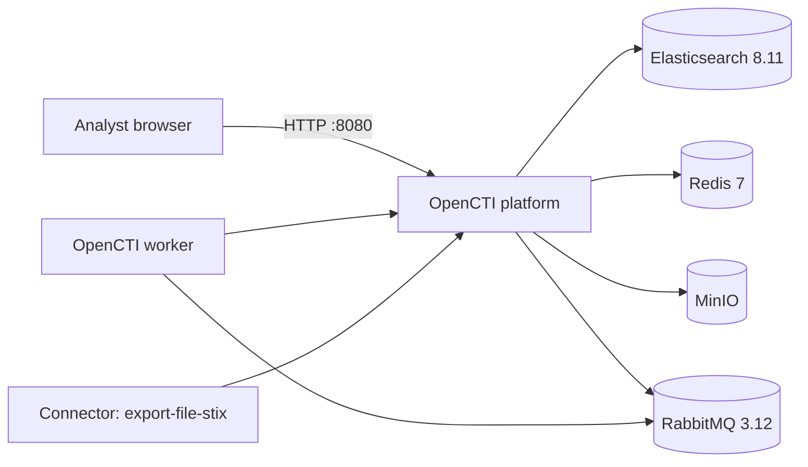

# poc_opencti

[](https://github.com/mylesagnew/poc_opencti/actions/workflows/shellcheck.yml)
[](LICENSE)


A one-script installer that stands up a single-node [OpenCTI](https://github.com/OpenCTI-Platform/opencti) threat-intelligence platform on Ubuntu with Docker Compose. It's built for **proof-of-concept labs, CTI training, and evaluation**.

> [!WARNING]
> **Not hardened for production.** Elasticsearch runs with `xpack.security` disabled, there is no TLS, and the web UI listens on plain HTTP port 8080. Run it on an isolated lab host or behind a VPN or reverse proxy. Don't expose it to the internet. See [Security notes](#security-notes).

---

## What it deploys



| Service | Image | Exposed on host |
|---|---|---|
| OpenCTI platform | `opencti/platform:5.12.15` | `0.0.0.0:8080` |
| Worker | `opencti/worker:5.12.15` | no |
| Export-file STIX connector | `opencti/connector-export-file-stix:5.12.15` | no |
| Elasticsearch | `docker.elastic.co/elasticsearch/elasticsearch:8.11.3` (single node, 1 GB heap) | no |
| Redis | `redis:7.0` | no |
| MinIO | `minio/minio:RELEASE.2023-11-01T18-37-25Z` | `127.0.0.1:9000` only |
| RabbitMQ | `rabbitmq:3.12-management` | no |

The installer writes `docker-compose.yml` and `.env` to `~/opencti-deployment/` at install time, so neither file is kept in this repo. [`.env.example`](.env.example) documents the variables for reference.

---

## Requirements

- Ubuntu 20.04, 22.04, 23.04, 23.10 or 24.04 (other versions prompt before continuing)
- A regular user with `sudo` (the script refuses to run as root)
- 8 GB RAM minimum (16 GB recommended), 2+ CPU cores, 20 GB+ free disk
- Outbound internet access for apt and Docker image pulls

## Install

```bash
git clone https://github.com/mylesagnew/poc_opencti.git
cd poc_opencti
less opencti-install.sh        # read it first; it uses sudo and changes system settings
./opencti-install.sh
```

The script:

1. Runs `apt update && apt upgrade` and installs prerequisites.
2. Installs Docker Engine and the Compose plugin from Docker's apt repo, and adds you to the `docker` group.
3. Tunes the host for Elasticsearch: `vm.max_map_count=262144` in `/etc/sysctl.conf`, and a `nofile` limit of 65536 in `/etc/security/limits.conf`.
4. Generates random secrets into `~/opencti-deployment/.env` (`chmod 600`) and writes `docker-compose.yml`.
5. Pulls the images, starts the stack, and waits for it to become healthy (allow 10–15 minutes on first boot).
6. Creates the `~/opencti-manage.sh` helper and prints the admin and service credentials.

If Docker reports *permission denied* after the group change, log out and back in (or run `newgrp docker`), then run the script again.

## Use

Open `http://<host-ip>:8080` and sign in with the admin email and password the installer printed. They are also stored in `~/opencti-deployment/.env`.

```bash
~/opencti-manage.sh status    # docker compose ps
~/opencti-manage.sh logs      # follow logs
~/opencti-manage.sh stop | start | restart
~/opencti-manage.sh update    # pull and recreate (images are version-pinned; edit the tags first)
```

## Uninstall

```bash
./uninstall-opencti.sh
```

This removes the containers, **all data volumes**, `~/opencti-deployment/` and `~/opencti-manage.sh`, and optionally the images. It does **not** uninstall Docker or revert the `sysctl.conf` and `limits.conf` changes. Remove those lines by hand if you need to.

---

## Security notes

- **Secrets** are generated per install with `openssl rand` and are never committed. The `.env` that used to be tracked here held placeholders only.
- **Elasticsearch security is disabled.** It isn't published to the host, but anything on the Compose network can reach it unauthenticated.
- **No TLS.** Put the UI behind a reverse proxy with TLS (Caddy, nginx or Traefik), or reach it over a VPN or SSH tunnel.
- **MinIO** is bound to `127.0.0.1`. Change the RabbitMQ and MinIO credentials if you reuse a deployment.
- **Pinned, ageing versions.** OpenCTI 5.12.15 dates from 2023. For anything beyond a lab, start from the [official OpenCTI Docker repo](https://github.com/OpenCTI-Platform/docker) and its current release.
- The installer runs `apt upgrade -y` and edits system files. Use a dedicated VM.

Report vulnerabilities in these scripts privately; see [SECURITY.md](SECURITY.md).

## License

[MIT](LICENSE) © 2025 Myles Agnew. OpenCTI itself is licensed by Filigran under its own terms.
